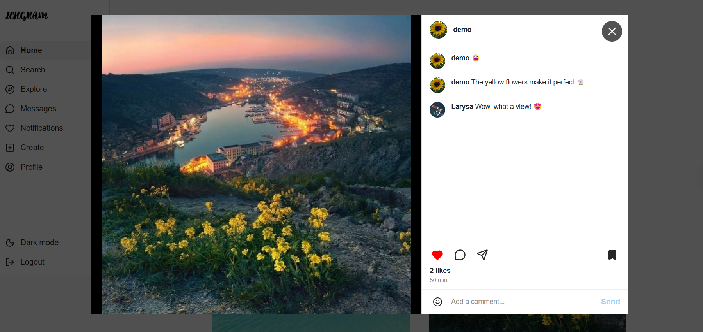
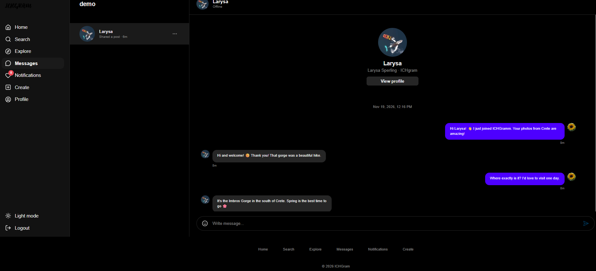

# 📸 ICHGramm

A full-stack, Instagram-style social network built as the final project of a full-stack web development course at ITCareerHub, then refactored after a full code review: a React SPA, a REST API on Express, real-time chat and notifications over Socket.io, MongoDB for data and Cloudinary for images.

## 🌐 Live Demo

| | |
|---|---|
| **App** (Vercel) | https://ich-gramm-seven.vercel.app |
| **API** (Render) | https://ichgramm-nqw0.onrender.com |
| **Health check** | https://ichgramm-nqw0.onrender.com/api/health |

**Demo account:** username `demo` · password `Demo12345`

> ⏳ The API runs on Render's free tier and sleeps when idle, so the first request can take 30–60 seconds. While the server wakes up, the app shows a banner.

## 🖼 Screenshots

| Feed | Profile | Post |
|---|---|---|
|  |  |  |

| Messages | Notifications | Mobile |
|---|---|---|
|  |  |  |

## ✨ Features

- **Auth**: registration, login by email or username, JWT, password reset by email
- **Profiles**: edit profile and avatar, follow/unfollow, followers and following lists, user search
- **Posts**: create, edit, delete, like, comment, save, explore page, infinite-scroll feed
- **Stories**: image stories that expire after 24 hours
- **Real-time chat**: private conversations, online status, typing indicator, seen status, edit/delete messages, share posts, emoji
- **Notifications**: likes, comments and follows, delivered in real time
- **UI**: responsive layout, mobile navigation, dark mode

## 🛠 Tech Stack

| Layer | Technologies |
|---|---|
| Frontend | React 19, Vite, React Router 7, Axios, Context API, Socket.io Client, Lucide React, emoji-picker-react, react-easy-crop |
| Backend | Node.js 20+, Express 5, Mongoose 9, Socket.io 4, JWT, bcrypt, Multer, express-validator, Helmet, express-rate-limit, Nodemailer |
| Data & hosting | MongoDB Atlas, Cloudinary, Vercel (client), Render behind Cloudflare (API) |

## 🏗 Architecture

```text
┌──────────────────┐   REST (HTTPS)   ┌──────────────────────┐      ┌───────────┐
│  React SPA       │ ───────────────▶ │  Express API         │ ───▶ │  MongoDB  │
│  (Vercel)        │                  │  + Socket.io server  │      └───────────┘
│                  │ ◀──────────────▶ │  (Render, behind     │      ┌────────────┐
└──────────────────┘    WebSocket     │   Cloudflare)        │ ───▶ │ Cloudinary │
                                      └──────────────────────┘      └────────────┘
```

- JWT authenticates both REST requests and the Socket.io handshake.
- Images are uploaded through the API (Multer) and stored in Cloudinary, so MongoDB only keeps URLs.
- A background job removes expired stories and their images every hour.

## 🔧 Engineering Highlights

After the first release I did a full code review of the project and fixed the findings in small PRs:

- **Security hardening**: Socket.io authentication, no sensitive fields in API responses, rate limiting on auth routes ([#1](https://github.com/LarysaSperling/ICHGramm/pull/1)). Blocked CORS requests return 403 ([#5](https://github.com/LarysaSperling/ICHGramm/pull/5)). Expired sessions return 401 and bad input returns 400 ([#7](https://github.com/LarysaSperling/ICHGramm/pull/7)).
- **Rate limiting behind Cloudflare**: the proxy chain was measured, `trust proxy` was set accordingly and limits are keyed on `CF-Connecting-IP` instead of a changing edge IP ([#2](https://github.com/LarysaSperling/ICHGramm/pull/2), [#4](https://github.com/LarysaSperling/ICHGramm/pull/4)).
- **Atomic operations**: likes and saves are atomic, so concurrent clicks can't produce duplicates. The `Follow` collection is the single source of truth, and scripts check data consistency ([#8](https://github.com/LarysaSperling/ICHGramm/pull/8)).
- **Real-time chat**: edits, deletions and typing indicators are delivered live, scoped per chat ([#9](https://github.com/LarysaSperling/ICHGramm/pull/9)). The server validates the receiver, the text and shared posts ([#10](https://github.com/LarysaSperling/ICHGramm/pull/10)).
- **Cloudinary migration**: images moved out of MongoDB (base64) into Cloudinary, with a one-off migration script ([#11](https://github.com/LarysaSperling/ICHGramm/pull/11)).
- **Cold-start UX**: a banner explains the delay while the free-tier server wakes up ([#13](https://github.com/LarysaSperling/ICHGramm/pull/13)).

## 📂 Project Structure

```text
ICHGramm/
├── server.js            # API entry point: Express, Socket.io, routes
├── src/
│   ├── config/          # MongoDB, Cloudinary, email, JWT
│   ├── controllers/     # Route handlers
│   ├── jobs/            # Expired-stories cleanup
│   ├── middlewares/     # Auth, rate limiting, uploads, validation, errors
│   ├── models/          # Mongoose models
│   ├── routes/          # REST routes
│   ├── services/        # Image storage, notifications
│   ├── socket/          # Socket.io events
│   ├── utils/
│   └── validators/      # express-validator rules
├── scripts/             # Consistency checks and image migration
└── client/              # React + Vite frontend
```

## ⚙ Installation

Requires Node.js 20–22, a MongoDB database and a Cloudinary account.

```bash
git clone https://github.com/LarysaSperling/ICHGramm.git
cd ICHGramm

# Backend (repo root)
npm install
npm run dev          # http://localhost:5000

# Frontend
cd client
npm install
npm run dev          # http://localhost:5173
```

Create a `.env` file in the repo root and another in `client/` (see below).

## 🔑 Environment Variables

### Backend (`.env`)

| Variable | Description |
|---|---|
| `PORT` | API port (default `5000`) |
| `MONGO_URI` | MongoDB connection string |
| `JWT_SECRET` | Secret for auth tokens |
| `RESET_TOKEN_SECRET` | Secret for password-reset tokens |
| `RESET_TOKEN_EXPIRES_IN` | Optional reset-token lifetime |
| `CLIENT_URL` | Frontend URL, used for CORS and reset links |
| `EMAIL_HOST`, `EMAIL_PORT` | SMTP server |
| `EMAIL_SECURE` | `true` for TLS (port 465) |
| `EMAIL_USER`, `EMAIL_PASSWORD` | SMTP credentials |
| `EMAIL_FROM` | Sender address |
| `CLOUDINARY_CLOUD_NAME`, `CLOUDINARY_API_KEY`, `CLOUDINARY_API_SECRET` | Cloudinary credentials (required, the server won't start without them) |
| `CLOUDINARY_FOLDER` | Upload folder, e.g. `ichgramm` in production and `ichgramm-test` locally |

### Frontend (`client/.env`)

| Variable | Description |
|---|---|
| `VITE_API_URL` | API base URL, e.g. `http://localhost:5000/api` |
| `VITE_SOCKET_URL` | Socket.io URL, e.g. `http://localhost:5000` |

## 📜 Scripts

Backend scripts run from the repo root:

| Command | Description |
|---|---|
| `npm start` | Start the API |
| `npm run dev` | Start the API with nodemon |
| `npm run check:follows` | Check follower/following data for inconsistencies |
| `npm run check:messages` | Check chat messages for inconsistencies |
| `npm run migrate:images` | One-off migration of base64 images to Cloudinary |

Frontend scripts run in `client/`: `npm run dev`, `npm run build`, `npm run lint`, `npm run preview`.

## 📡 API Endpoints

All routes are prefixed with `/api`. 🔒 marks routes that require a JWT.

<details>
<summary><b>Show endpoints</b></summary>

**Auth**: `/api/auth`
```http
POST /register
POST /login
POST /reset-password
POST /reset-password/:token
```

**Users**: `/api/users`
```http
GET  /profile            🔒
PUT  /profile            🔒
GET  /profile/posts      🔒
GET  /me/posts           🔒
GET  /search             🔒
GET  /share-list         🔒
GET  /saved              🔒
POST /saved/:postId      🔒
GET  /:id                🔒
```

**Posts**: `/api/posts`
```http
GET    /
GET    /explore
GET    /:id
POST   /                 🔒
POST   /:id/like         🔒
PUT    /:id              🔒
DELETE /:id              🔒
```

**Comments**: `/api/comments`
```http
GET    /:postId
POST   /:postId              🔒
PUT    /comment/:commentId   🔒
DELETE /comment/:commentId   🔒
```

**Follows**: `/api/follows`
```http
POST   /:userId              🔒
DELETE /:userId              🔒
GET    /:userId/followers
GET    /:userId/following
```

**Stories**: `/api/stories`
```http
GET    /                 🔒
GET    /my               🔒
POST   /                 🔒
DELETE /:id              🔒
```

**Messages**: `/api/messages`
```http
GET    /                     🔒
GET    /:userId              🔒
POST   /                     🔒
PUT    /:userId/seen         🔒
PUT    /message/:messageId   🔒
DELETE /message/:messageId   🔒
DELETE /chat/:userId         🔒
```

**Notifications**: `/api/notifications`
```http
GET    /                 🔒
PUT    /read-all         🔒
PUT    /:id/read         🔒
DELETE /clear            🔒
DELETE /:id              🔒
```

**Health**
```http
GET /api/health
```

</details>

## 🚀 Future Improvements

- Video posts
- Group chats
- Push notifications
- Automated tests and CI

## 👩‍💻 Author

**Larysa Sperling**, Full Stack Developer

[GitHub](https://github.com/LarysaSperling) · [LinkedIn](https://www.linkedin.com/in/larysa-sperling-16969a3a2)
